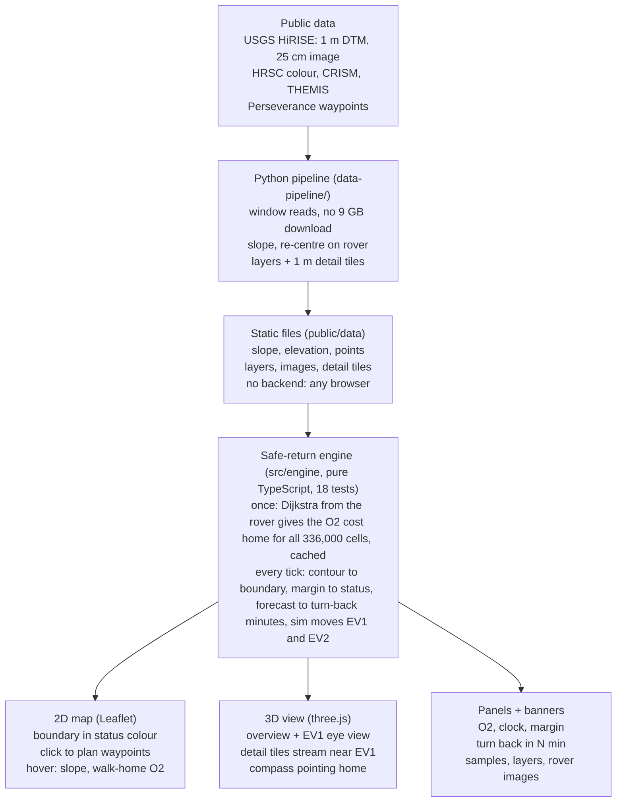

# Marswalk technical brief for the pitch

Snapshot of 2026-11-14. The live, editable version is the team's Claude Doc "Marswalk technical brief for the pitch"; edit there and refresh this copy.

Marswalk is a planning and live-navigation map for a two-astronaut EVA at Bright Angel (Neretva Vallis, Jezero Crater) that shows, minute by minute, how far the crew can go and still walk back to the rover on its oxygen.

## The pitch in 30 seconds

On a Mars EVA the hard question is not "where is the rock?" but "can we still get back?". The answer shrinks every minute as oxygen runs down, and it depends on the terrain: a channel wall can turn a 400 m straight line into a 1.1 km walk.

Marswalk draws that answer on the map. Around the parked rover it shows a **safe-return boundary**: every place the crew can reach and still walk home on the oxygen left, minus a 30-minute reserve. It is computed from real orbital terrain of Bright Angel, where Perseverance found the "leopard spot" rock Cheyava Falls in July 2024.

- **Plan mode:** click waypoints; the route avoids walls steeper than 20 degrees and shows time, oxygen used and the margin left on arrival.
- **Navigate mode:** the sim walks two astronauts along the route; oxygen and time tick down, the boundary shrinks and turns yellow then red, and banners say when to turn back.
- **3D:** fly over the real terrain, or stand in EV1's boots at eye height with a compass pointing home.
- **Science context:** natural-colour, mineral and thermal layers, plus the real rover images of Cheyava Falls, so the crew knows what to sample when they get there.

## Live demo script (about 3 minutes)

Run `npm install` then `npm run dev` and open the URL it prints (Vite default `http://localhost:5173`). Rehearse once: the first 3D load streams about 9 MB of terrain tiles.

1. **Plan mode, 2D map.** The app opens with a route from the rover to Cheyava Falls. Say: "The straight line is about 1 km, but the channel wall is too steep, so the route goes around: 1.14 km, about 53 minutes, 71 minutes of oxygen." Point at the green boundary: "That's where we could be on arrival and still get home."
2. **Hover the map.** The box bottom-left shows latitude/longitude, height, slope and "Walk home: N min O2". Hover a red (steep) area: it says "impassable".
3. **Click Cheyava Falls.** The panel shows NASA's Mastcam-Z context shot and the WATSON close-up of the leopard spots. Say: "This is what the crew is looking for."
4. **Layers panel.** Switch the base map to Minerals, then Thermal inertia: "Low thermal inertia means sand; that's the ripple field on the channel floor." Switch back to Natural colour.
5. **Navigate, speed 10, Play.** O2 and time count down, the boundary shrinks and turns yellow ("Turn back in N min at current pace") then red ("TURN BACK NOW"). The dust-devil banner appears at 12:00 local.
6. **3D view, Overview.** Drag to orbit the channel. Then **EV1 eye view**: "Same data, from 1.7 m. The compass at the bottom always points home."
7. **Return to rover** to show the replanned route home.

If something breaks on stage: Reset in Navigate restarts the sim; the 2D map works without the 3D files.

## Architecture



Python scripts turn public Mars data into static files once; in the browser, the engine computes the cost home from every cell once and every view reads that result. Stack: React 18 + Vite + TypeScript, Leaflet in a local metre grid (`L.CRS.Simple`, not lat/lon), three.js loaded only when 3D opens, Vitest for tests, Python (numpy, rasterio/GDAL) for the pipeline. All coordinates are metres from the rover: x east, y north.

## How the safe-return boundary works

The boundary is every 5 m cell whose oxygen cost to walk back to the rover fits in the oxygen left minus a 30-minute reserve. Four steps, all in `src/engine/` (pure TypeScript, unit-tested):

1. **Cost of one step.** Oxygen is counted in "minutes at rest". Walking a distance on a slope costs breathing for the time it takes plus extra effort per metre; slope makes both worse (slower and harder). Cells steeper than 20 degrees are walls.

   ```
   O2(d, s) = d / (v0 / (1 + s/10)) * 1  +  d * 0.01 * (1 + s/10),   v0 = 2 km/h
   ```

2. **Cost from everywhere to the rover.** One Dijkstra shortest-path run over the 580 x 580 grid (8 neighbours, no corner-cutting between walls). Because a step costs the same both ways (average slope of the two cells), one run from the rover gives the cost home from every cell. It depends only on terrain, so it runs once (~100 ms) and is cached.
3. **Draw the boundary.** Each tick: budget = O2 left - 30 min reserve. Marching squares traces where cost = budget into polygons. Rings smaller than 20 cells (noise around single steep cells) are dropped; holes show steep patches you can't enter.
4. **Status and turn-back time.**
    - Margin = budget - cost home of the furthest-out astronaut. Margin under 20 min = warn (yellow), under 10 = turn back (red).
    - "Turn back in N min" is a forecast: the engine simulates the crew continuing along the planned route at the sim's pace in 30-second steps (walking burns more O2 and usually moves them further from home), then standing at the route's end, and reports when the margin hits zero.

**Routes** use the same Dijkstra between consecutive waypoints, so the planned path and the boundary agree. **The sim** advances the lead astronaut along the route at the slope-dependent speed; EV2 follows 15 m behind; O2 drops by breathing plus walking effort.

## Data: what is real and where it comes from

The terrain, imagery, science layers, rover images and Cheyava Falls position are real published data; the EVA itself (rover parking spot, sample spots, hazards, oxygen numbers) is notional. Everything lives in `public/data/` as static files, produced by Python scripts in `data-pipeline/`.

| Layer | Used for | Resolution in app | Source |
| --- | --- | --- | --- |
| Elevation (DTM) | Slope, boundary, 3D terrain | 5 m grid; 1 m in close-up tiles | USGS Mars 2020 TRN HiRISE DTM mosaic, Fergason et al. 2020 |
| HiRISE image | Grey base map, image detail | 2 m; 25 cm in close-up tiles | USGS Mars 2020 TRN HiRISE orthomosaic |
| Natural colour | Default base map | ~50 m colour, 2 m detail | HRSC colour mosaic (ESA/DLR/FU Berlin, UDL Lyon), sharpened with HiRISE |
| Minerals | Science layer | ~18 m CRISM, stored at 36 m | Dominant-mineral map, Saranathan, Parente & Itoh (Zenodo) |
| Thermal inertia | Footing hint (sand vs rock) | ~100 m | THEMIS mosaic, Edwards & Buz (Zenodo) |
| Cheyava Falls position | Target point | tens of metres | Perseverance waypoints, sols 1210-1218 (Jul 2024) |
| Rover traverse | Validation only | ~1 m | Perseverance traverse file (NASA MMGIS) |
| Site images | Cheyava Falls panel | photo | NASA/JPL releases PIA26401 (Mastcam-Z, sol 1217) and PIA26368 (WATSON, sol 1212) |

**How we avoid downloading 9 GB:** the USGS mosaics are 1.8 GB (elevation) and 7.4 GB (image). The pipeline reads only the bytes it needs over HTTP (GDAL `/vsicurl/` with direct I/O), so a 512 m tile at 25 cm takes about 6 seconds.

**Pipeline order:** `crop_remote.py` (window reads) -> `slope_from_dtm.py` (slope like `gdaldem`, Horn's method, averaged to 5 m) -> `export_slope.py` / `export_elevation.py` (re-centred on the rover) -> `make_points.py` -> `make_basemap.py` -> `make_layers.py` -> `make_detail_tiles.py`. Exact commands are in `data-pipeline/README.md`.

## 3D view

The 3D view shows the same route, boundary, points and astronauts as the map, on the real terrain, and only downloads three.js when someone opens it.

- **Terrain:** a 580 x 580 mesh from the 5 m elevation grid (about 336,000 vertices), with the chosen base map and the slope heatmap painted on as one texture. Overview has a 1x-4x height exaggeration slider.
- **Close-up tiles:** around the rover, Cheyava Falls and the samples (2 x 1.5 km, 12 tiles of 512 m), the scene streams 1 m terrain and 25 cm imagery, nearest EV1 first (8.6 MB in total). The coarse terrain is sunk 3 m underneath so the sharp tile always wins.
- **EV1 eye view:** camera at 1.7 m above the ground under EV1, true scale, facing 30 m further along the route (or toward the rover once the route ends). Drag to look around. A compass at the bottom gives "Rover 660 m, behind".
- **Camera safety:** in Overview the camera is kept at least 25 m above the ground under it and the orbit point stays on the map, so you can't end up inside a hill.
- **Hover readout (2D and 3D):** latitude/longitude, height relative to the rover and to the Mars areoid, slope ("impassable" above 20 degrees), and the O2 cost to walk home from that point.

Code: `src/three/MarsScene.ts` (plain three.js class), `src/three/detailTiles.ts`, `src/three/View3D.tsx` (React wrapper). Map points are "x = east, y = north, metres from the rover"; three.js uses y = up, so the scene maps (x, y, height) to (x, height, -y).

## Validation: how we know it works

The safety maths has 18 automated tests, and our slope processing agrees with where Perseverance actually drove.

**Automated tests (`npm test`, Vitest):**

- Flat ground: a straight 40 m walk costs exactly the formula's O2; diagonals cost the square root of 2 per cell.
- Slope makes the same distance cost at least 1.5x more.
- A full wall over 20 degrees makes the far side unreachable; a gap is found, at a higher cost; exactly 20 degrees is still passable.
- Status thresholds (ok / warn / turn back), and the boundary shrinking as O2 drops.
- Turn-back forecast: walking away on flat ground halves the time compared with standing still (3.75 vs 10 min), matching the hand calculation.
- Data checks on the real files: grid sizes match, one rover at (0, 0), elevation lines up with slope, and Cheyava Falls is reachable on foot.

**Perseverance traverse check** (`data-pipeline/check_traverse.py`): rover planners steer around steep ground, so if the real path crosses many cells we call impassable, our slope is too strict. Over 12.4 km of real traverse in our crop:

| 5 m resampling | Path median slope | Path over 20 degrees | All terrain over 20 degrees |
| --- | --- | --- | --- |
| Mean (used) | 7.0 degrees | 0.3% | 10.3% |
| Max | 10.0 degrees | 4.4% | 22.0% |

We use the mean: it agrees with the real drive, while max would put walls on 1 in 23 metres of a path the rover actually drove (mostly noise in the 1 m elevation data). The check only shows max is too strict; the rover's limits differ from an astronaut's, so it does not prove the mean is exactly right.

## Honest limits

The boundary's shape comes from real terrain, but its size rests on placeholder physiology: present minutes and metres as "with placeholder numbers", never as mission-ready figures.

| Limit | Effect | Fix next |
| --- | --- | --- |
| O2 rates, walking speed, 20 degree limit, 30 min reserve are round placeholders (`src/engine/config.ts`) | Sets how big the boundary is | Source from Apollo EVA and suit studies; show a pessimistic/optimistic band |
| Uphill and downhill cost the same; climbing and traversing a slope cost the same | Return trips out of the channel are underestimated | Direction-aware cost (one reverse search still works) |
| Map projection is true to scale only at the equator | East-west distances about 5% too long | Re-project the elevation data centred on 18.5 N |
| 1 m elevation noise inflates slope | Some false walls | Mean resampling (validated above); smoothing |
| Rocks under about 75 cm are invisible from orbit | Eye view is soft at your feet | Perseverance Navcam/Mastcam-Z terrain models of the site (PDS) |
| Rover parking spot, sample spots, hazards are invented | Demo scenario only | Science lead places them from the rover images |
| One shared O2 number; dust-devil window hard-coded | Simplified crew model | Per-suit telemetry; forecast or climatology |
| npm reports 14 known vulnerabilities in dependencies | Not reviewed | `npm audit` before any public deployment |

Other honest notes: "Turn back in N min" assumes the current pace continues. Mineral names are closest-match prototypes from the dataset, not confirmed identifications; only 37% of our area matched a mineral.

## Numbers to remember

| What | Number |
| --- | --- |
| Study area | 2.9 x 2.9 km around the rover, 5 m cells (580 x 580) |
| Relief in study area | 75 m below to 307 m above the rover |
| Rover to Cheyava Falls | about 1.05 km straight line; 1.14 km walked route, ~53 min, 71 min O2 |
| Margin on arrival (default plan) | 69 min of O2 beyond the reserve |
| Starting O2 / reserve | 240 min / 30 min (placeholders) |
| Status thresholds | warn under 20 min margin, turn back under 10 |
| Walking speed | 2 km/h on flat ground, halved at 10 degrees |
| Steepest walkable | 20 degrees |
| Ground steeper than 20 degrees | 10.3% of the terrain; 0.3% of Perseverance's real path |
| Close-up detail | 1 m terrain + 25 cm imagery over 2 x 1.5 km (12 tiles, 8.6 MB) |
| Source files we avoid downloading | 1.8 GB elevation + 7.4 GB imagery |
| Cheyava Falls dates | WATSON close-up sol 1212 (18 Jul 2024); core sample drilled 21 Jul 2024; Mastcam-Z workspace sol 1217 |
| Automated tests | 18 |
| App download | about 100 KB gzipped for the map; about 135 KB more for 3D, only when opened |

## Suggested slide outline (9 slides)

1. **Title.** "Marswalk: how far can you go and still get home?" Visual: 3D overview of Neretva Vallis with the green boundary.
2. **The problem.** Oxygen is the clock; terrain decides the distance. Visual: straight line from rover to Cheyava Falls (~1 km) vs the walked route around the wall (1.14 km).
3. **The site.** Bright Angel, Cheyava Falls, the leopard spots. Visual: PIA26368 annotated close-up + PIA26401 workspace (credit NASA/JPL-Caltech/MSSS and NASA/JPL-Caltech/ASU/MSSS).
4. **What Marswalk does.** Plan / Navigate / 3D in one line each. Visual: screenshot of 2D map with boundary and hover readout.
5. **How the boundary works.** The four steps: step cost -> cost to rover from everywhere -> contour -> status/forecast. Visual: the architecture diagram or a 4-box flow.
6. **Real data.** The data table, condensed: elevation, imagery, colour, minerals, thermal, rover images. Visual: the base-map picker on Minerals and Thermal.
7. **Live demo** (or a 60-second screen recording as backup): plan -> navigate until red -> eye view with compass.
8. **Is it right?** 18 tests + traverse check (0.3% vs 4.4%). Visual: the validation table.
9. **Limits and next steps.** Placeholder physiology, direction-aware cost, projection fix, rover-level 3D. Close on the one-liner.

Tip: keep one number per slide; the numbers table above has them all.

## Likely judge questions

| Question | Short answer |
| --- | --- |
| Is the terrain real? | Yes: USGS's controlled HiRISE elevation model (1 m) and imagery (25 cm) of Jezero, made for Perseverance's landing hazard map. We read only the window we need. |
| Are the oxygen numbers real? | No, they're round placeholders in one config file. The method is the point; sourced values from Apollo and suit studies are the first next step. |
| Why a 20 degree limit? | Placeholder for "too steep to walk safely in a suit". It's one constant; change it and the walls and boundary update. |
| Why Dijkstra and not A*? | We need the cost home from every cell at once, not one path. One Dijkstra run from the rover gives all of them because step costs are symmetric. A* is for one target. |
| How fast is it? | The cost field is computed once (~100 ms for 336,000 cells) and cached; each tick only re-traces the contour, so it updates live at 10 ticks per second. |
| How do you know the slope is right? | We checked against 12.4 km of Perseverance's real path: only 0.3% of it crosses cells we call too steep. A stricter method put 4.4% of a real drive on "walls", so we rejected it. |
| What does "turn back in N min" assume? | That the crew keeps walking the planned route at the current pace, then stands at its end. We simulate forward and report when the margin hits zero. |
| Why is the eye view soft up close? | Orbital imagery is 25 cm per pixel; at your feet one pixel fills dozens of screen pixels, and rocks under ~75 cm don't show. Beyond ~10 m it's sharp. Rover-level data (Navcam/Mastcam-Z terrain models) is the upgrade. |
| Are the leopard spots on the map? | No: they're millimetre-scale. The map gets the crew to the rock; the panel shows NASA's WATSON close-up so they know what to sample. |
| What's real in the mineral layer? | A published CRISM map with its official colour key. Names are closest-match prototypes, and only 37% of our area matched one. |
| Does it need internet or a server? | No backend: static files and a browser. It would run on a laptop in the rover. |
| What about two astronauts separating? | Status uses the furthest-out astronaut. A separation limit is on the next-steps list. |
| What did you build vs reuse? | Built: engine, UI, 3D, pipeline. Reused: open data (USGS, ESA/DLR, CRISM and THEMIS teams, NASA/JPL) and libraries (React, Leaflet, three.js, GDAL/rasterio). |

## Team, credits and sources

Owners are still TBD in the README; fill this in so each person can take the questions in their area.

| Area | Owner | Main files |
| --- | --- | --- |
| UI (2D map, panels) | TBD | `src/components/`, `src/App.tsx`, `src/styles.css` |
| Safe-return engine | TBD | `src/engine/` |
| 3D view | TBD | `src/three/` |
| Data pipeline | TBD | `data-pipeline/`, `public/data/` |
| Science mode (samples, layers, images) | TBD | `points.json`, `images.json`, `make_layers.py` |
| Pitch | TBD | this brief |

**Credits:** the natural-colour, mineral and thermal layers and the hover lat/lon idea are ported from Mughani05's [marswalk3d](https://github.com/Mughani05/marswalk3d), regenerated on our Bright Angel grid.

**Sources (pages opened while building):**

- [PIA26368: Perseverance Finds a Rock With 'Leopard Spots'](https://www.jpl.nasa.gov/images/pia26368-perseverance-finds-a-rock-with-leopard-spots/) (WATSON, sol 1212; credit NASA/JPL-Caltech/MSSS)
- [PIA26401: Mastcam-Z Views the 'Cheyava Falls' Workspace](https://www.jpl.nasa.gov/images/pia26401-mastcam-z-views-the-cheyava-falls-workspace/) (sol 1217; credit NASA/JPL-Caltech/ASU/MSSS)
- [PIA26344: Perseverance's Selfie With 'Cheyava Falls'](https://www.jpl.nasa.gov/images/pia26344-perseverances-selfie-with-cheyava-falls/)
- [NASA Mars Trek](https://trek.nasa.gov/mars/) (catalogue listing of the USGS Jezero HiRISE DEM and mosaic)
- [CRISM dominant-mineral map of the Mars 2020 landing ellipse](https://zenodo.org/records/5575824) (Saranathan, Parente & Itoh; colour key in its Jezero_readme.pdf)
- [THEMIS thermal inertia of Jezero](https://zenodo.org/records/4931348) (Edwards & Buz)
- Elevation and imagery: USGS Mars 2020 Terrain Relative Navigation HiRISE DTM and orthomosaic, Fergason et al. 2020 ([doi:10.5066/P9REJ9JN](https://doi.org/10.5066/P9REJ9JN))
- Natural colour: [HRSC Jezero colour mosaic, UDL Lyon](https://marssi.univ-lyon1.fr/data/MARS/MRO/CTX/Jezero/) (ESA/DLR/FU Berlin)
